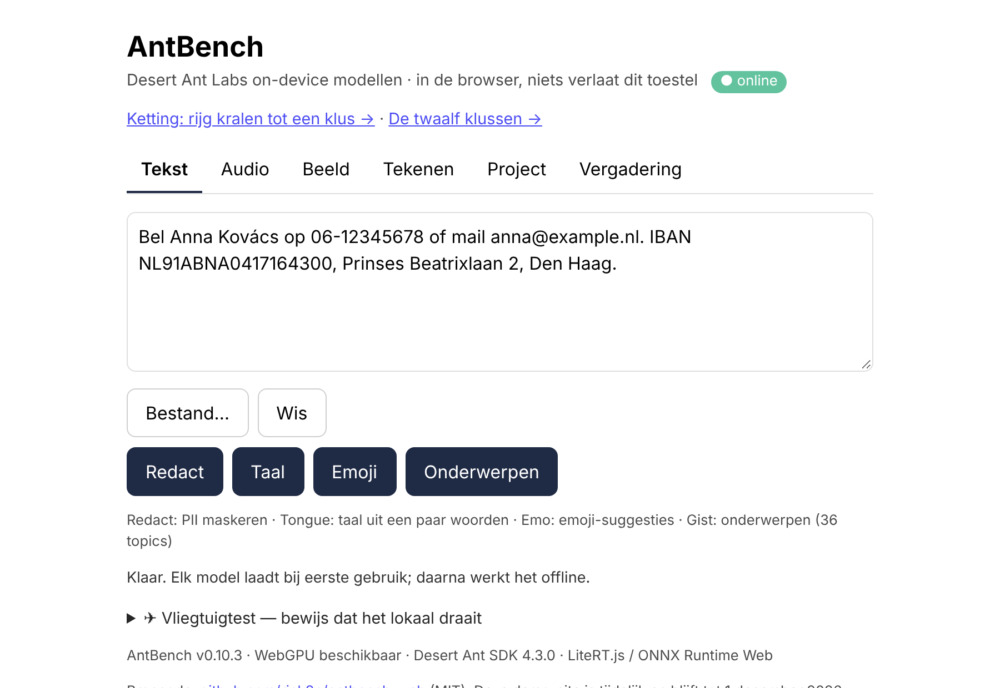
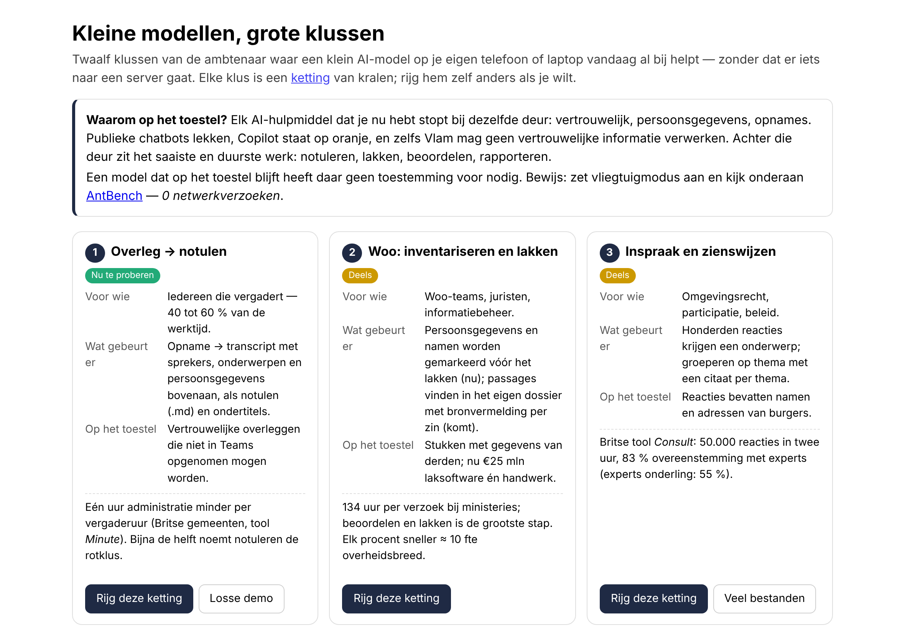
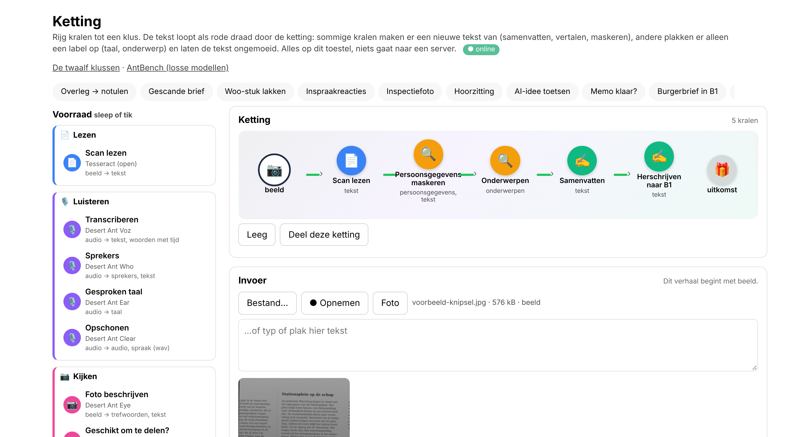
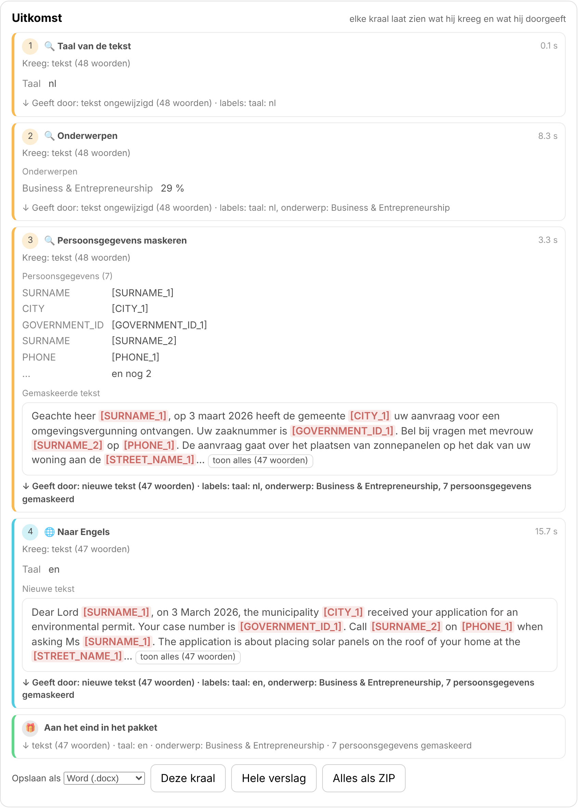
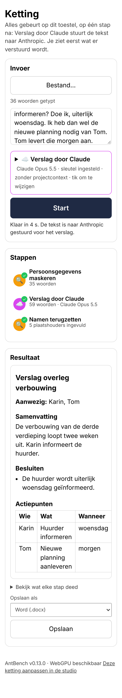
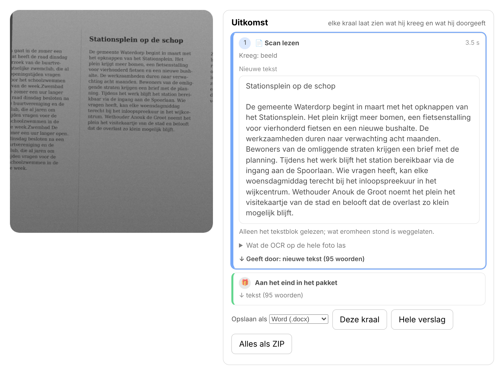
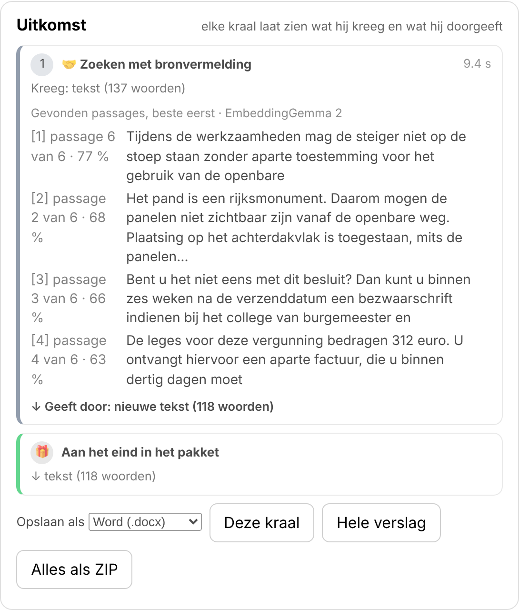
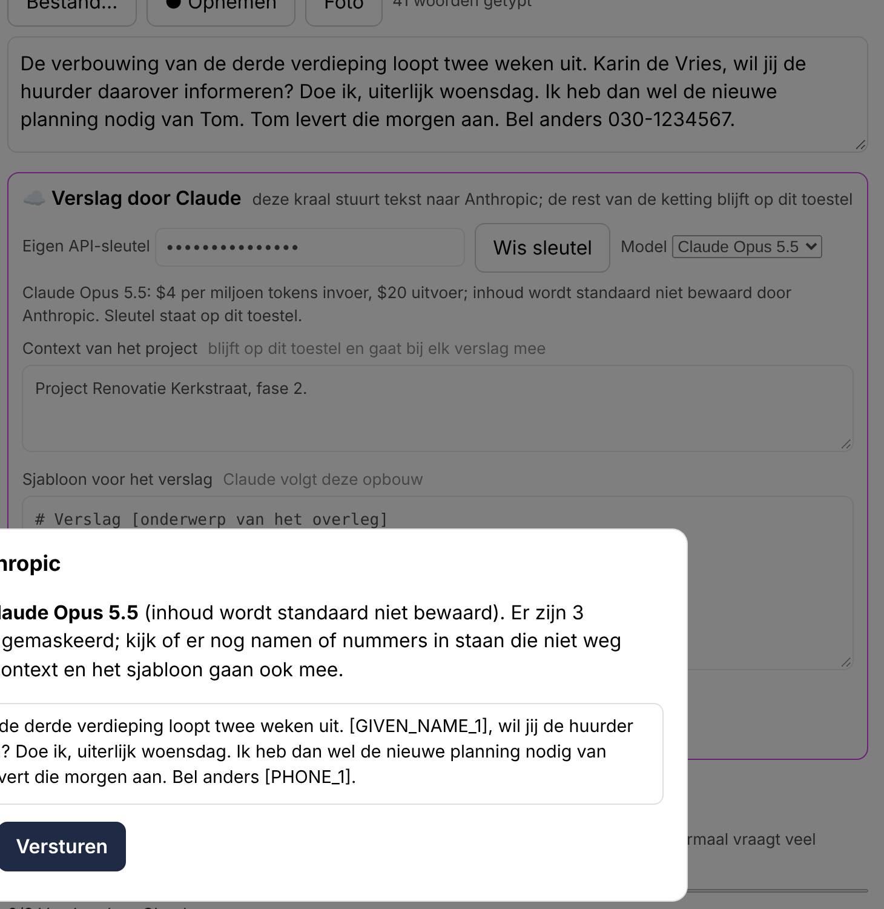
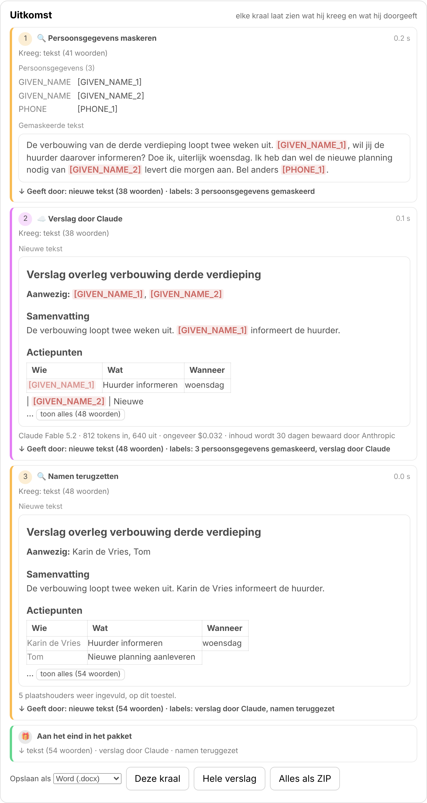
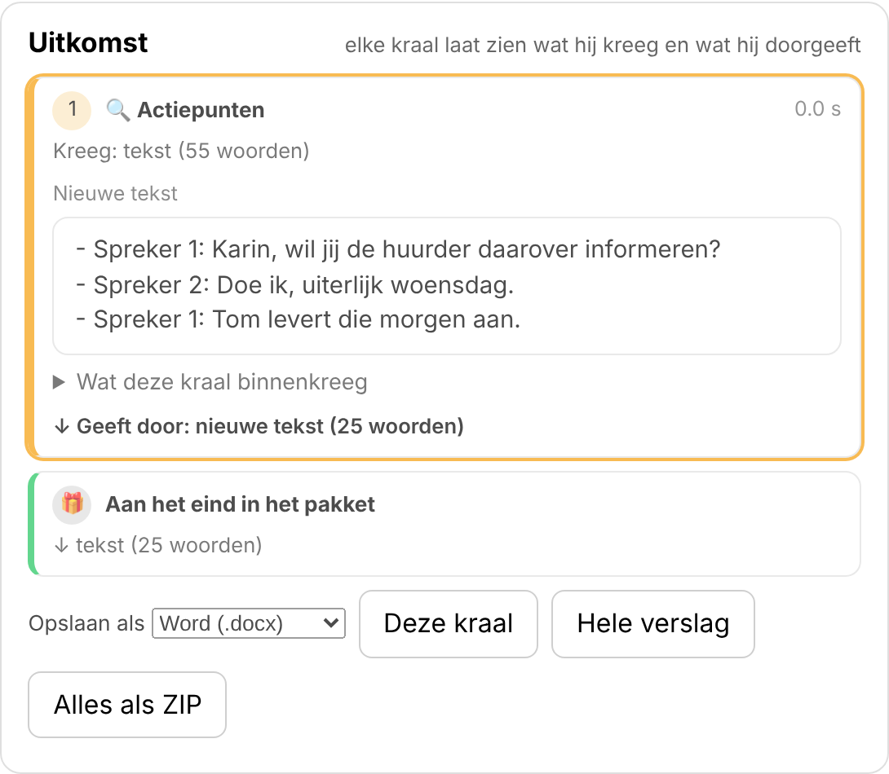

# antbench-web

Kleine AI-modellen die **in de browser** draaien, op je eigen telefoon of laptop.
Wat je invoert (een opname, een foto, een tekst) wordt op het toestel zelf verwerkt;
de server levert alleen de bestanden van de app. Bedoeld om te laten zien wat een
ambtenaar met kleine, lokale modellen kan, zonder dat een document de deur uitgaat.

Proberen: **https://dev.3n.nl/antbench/** (demo-site, tijdelijk tot 1 december 2026).

De modellen komen van [Desert Ant Labs](https://desertant.com) (spraak, sprekers,
beeld, taal, onderwerpen, persoonsgegevens) en uit open bronnen (OCR, vertalen,
zoeken, schrijven, voorlezen). Zie [Bronnen en dank](#bronnen-en-dank).

## Drie ingangen

| Ingang | Waar | Voor wie |
|---|---|---|
| **AntBench** | [`/antbench/`](https://dev.3n.nl/antbench/) | Eén model tegelijk proberen: wat doet Voz met mijn opname, wat ziet Eye in mijn foto |
| **Menukaart** | [`/antbench/werkbank/`](https://dev.3n.nl/antbench/werkbank/) | Twaalf klussen uit het werk van een ambtenaar, elk met een knop naar een kant-en-klare ketting |
| **Ketting** | [`/antbench/ketting/`](https://dev.3n.nl/antbench/ketting/) | Zelf modellen achter elkaar rijgen tot een klus |

## De ketting

Een **kraal** is één model of één bewerking. Je sleept kralen uit de voorraad in de
volgorde die je wilt, geeft de ketting een opname, foto of tekst, en elke kraal
geeft zijn resultaat door aan de volgende.

### Hoe het doorgeven werkt

Door de ketting reist één **pakket**. Daarin zit wat er op dat moment is: audio,
beeld, tekst, en labels zoals de taal of het onderwerp.

- **De tekst is de rode draad.** Sommige kralen maken er een nieuwe tekst van
  (transcriberen, scan lezen, maskeren, samenvatten, vertalen). De volgende kraal
  werkt dan met die nieuwe tekst.
- **Andere kralen plakken alleen een label op het pakket** (taal, onderwerp,
  sprekers). De tekst zelf gaat ongewijzigd door.
- **Labels worden gebruikt.** *Naar Engels* slaat over als het taallabel al
  Engels zegt; *Transcriberen* deelt de tekst per spreker in als *Sprekers* al
  gedraaid heeft.
- **Een schakel is groen of rood.** Groen: de kraal krijgt wat hij nodig heeft.
  Rood: er ontbreekt iets, bijvoorbeeld *Transcriberen* zonder audio.

De uitkomst is een **logboek**: per kraal een kaart die verschijnt zodra hij klaar
is, met wat hij kreeg, wat hij opleverde en wat er doorgaat. Zo zie je ook de
tussenresultaten.

In dit voorbeeld zie je ook waar het misgaat: het onderwerp klopt niet (de lijst
van 36 onderwerpen is Engels en algemeen) en de vertaling maakt van "heer"
"Lord". Het logboek is er juist om dat te kunnen zien.

Een ketting deel je met de knop *Deel deze ketting*: de volgorde staat in het
adres (`#k=ocr,redact,samenvatten`). Tekstresultaten sla je op als Word, PDF of
Markdown, per kraal of als heel verslag; *Alles als ZIP* geeft ook de audio.

### Gebruikersscherm: een ketting voor op de telefoon

De studio is om kettingen te bouwen. Wie een ketting alleen wil gebruiken, heeft de voorraad en het slepen niet nodig. *Deel voor gebruikers* geeft een link naar dezelfde ketting als eenvoudige pagina: de invoer die de ketting nodig heeft (opnemen, foto of tekst), één knop *Start*, de stappen als lijstje en daaronder het resultaat met *Opslaan*. Alles staat onder elkaar en past op een telefoon. Wat elke stap deed staat ingeklapt onder het resultaat.

De link is de studiolink met `&u=1` erachter, bijvoorbeeld `…/ketting/#k=voz,who,redact,claude,terugzetten&u=1`. Onderaan staat een link terug naar de studio.

### Archief: sessies terughalen

Elke run wordt bewaard in het archief op het toestel (IndexedDB in de browser): de invoer, de ketting, wat elke stap opleverde en het resultaat. Onder *Archief* staat de lijst; *Open* zet een sessie terug zoals hij was, zodat je het resultaat opnieuw kunt opslaan als Word of PDF.

- **Opnieuw vanaf een stap.** Open een stap en kies *Opnieuw vanaf deze stap*, of gebruik *Verslag opnieuw maken*: de eerdere stappen blijven staan. Zo maak je een verslag met een ander sjabloon zonder opnieuw te transcriberen.
- **ZIP.** Per sessie een bestand met alles erin, als back-up of om naar een ander toestel te verhuizen (*Sessie uit ZIP…*).
- **Bewaartermijn.** Standaard 30 dagen; daarna wordt een sessie bij het openen van de pagina verwijderd. Instelbaar op 7, 30 of 90 dagen of altijd. *Alles wissen* leegt het archief.
- **Opname.** De opname gaat standaard mee, zodat je opnieuw kunt transcriberen. Uitvinken scheelt ruimte.

Wat je moet weten: het archief bevat de ongemaskeerde invoer en de echte namen, onversleuteld. De API-sleutel zit er niet in. Browseropslag is geen back-up: de browser mag hem wissen bij ruimtegebrek, Safari doet dat na zeven dagen niet gebruiken (tenzij de app op het beginscherm staat), en het archief hoort bij het webadres. Bewaar wat belangrijk is als ZIP.

## De kralen

*Krijgt → geeft* zegt wat een kraal uit het pakket nodig heeft en wat hij
toevoegt. Staat er bij *geeft* "tekst", dan vervangt de kraal de tekst die
doorgaat; anders gaat de tekst ongewijzigd door.

### 📄 Lezen

| Kraal | Model | Krijgt → geeft | Wat hij doet |
|---|---|---|---|
| **Scan lezen** | Tesseract (Nederlands) | beeld → tekst | Leest de tekst uit een foto of scan. Maakt de foto eerst leesbaar (schaduw weg, contrast), zoekt het tekstblok, leest alleen dat blok, en zet afgebroken woorden en regels weer aan elkaar tot alinea's. Meldt hoe zeker de herkenning is. |

### 🎙️ Luisteren

| Kraal | Model | Krijgt → geeft | Wat hij doet |
|---|---|---|---|
| **Transcriberen** | Desert Ant Voz | audio → tekst | Spraak naar tekst, met per woord het tijdstip. Herkent de taal zelf. |
| **Sprekers** | Desert Ant Who | audio → sprekers, tekst | Wie sprak wanneer. Is er al een transcript, dan wordt het per spreker ingedeeld. |
| **Gesproken taal** | Desert Ant Ear | audio → taal (label) | Welke taal er gesproken wordt, uit de eerste halve minuut. |
| **Opschonen** | Desert Ant Clear | audio → audio | Ruis en galm weg, volume gelijkgetrokken. Bedoeld om terug te luisteren. Niet vóór *Transcriberen* zetten: het transcript wordt er slechter van. |
| **Stopwoordjes** | Desert Ant Uhm | audio → stopwoordjes (label) | Telt de eh's en uhm's in een opname en geeft aan waar ze zitten. |

### 📷 Kijken

| Kraal | Model | Krijgt → geeft | Wat hij doet |
|---|---|---|---|
| **Gezichten vervagen** | Desert Ant Face (alleen de detector) | beeld → beeld | Zoekt gezichten en maakt ze onherkenbaar met grove blokken. De bewerkte foto gaat door naar de volgende kraal. Het model zoekt alleen waar een gezicht zit; het herkent niet wie het is. |
| **Foto beschrijven** | Desert Ant Eye | beeld → trefwoorden, tekst | Scène, trefwoorden, mensen, dieren, kwaliteit. Geeft een korte beschrijving door als tekst. |
| **Geschikt om te delen?** | Desert Ant Moderator | beeld → oordeel (label) | Schat in of een foto ongepast is. Een close-up met veel huid scoort al snel hoog. |

### 🔍 Begrijpen

| Kraal | Model | Krijgt → geeft | Wat hij doet |
|---|---|---|---|
| **Taal van de tekst** | Desert Ant Tongue | tekst → taal (label) | Stelt de taal vast. |
| **Onderwerpen** | Desert Ant Gist | tekst → onderwerp (label) | Waar de tekst over gaat, gekozen uit 36 vaste onderwerpen. |
| **Persoonsgegevens maskeren** | Desert Ant Redact | tekst → tekst, lijst | Namen, adressen en nummers worden plaatshouders zoals `[GIVEN_NAME_1]`. Dezelfde naam krijgt overal hetzelfde nummer. De gemaskeerde tekst gaat door, zodat latere kralen de gegevens niet meer zien. Het model mist weleens een naam: kijk de tekst na voordat je hem verstuurt. |
| **Haatdragende taal?** | Desert Ant Toxic | tekst → toon (label) | Signaleert haatdragende, beledigende of bedreigende taal, in 35 talen. Een eerste zeef, geen oordeel. |
| **Actiepunten** | vaste regels, geen model | tekst → tekst | Haalt de zinnen eruit waarin iets moet gebeuren, gevraagd, afgesproken of besloten wordt, met de spreker erbij. |
| *Eigen labels zoeken* | GLiNER | tekst → lijst | *Komt.* Zoeken op labels in gewone taal: BSN, kenteken, zaaknummer. |

### ✍️ Schrijven (taalmodel, vraagt WebGPU)

| Kraal | Model | Krijgt → geeft | Wat hij doet |
|---|---|---|---|
| **Samenvatten** | Qwen3 | tekst → tekst | Korte samenvatting in het Nederlands. Lange teksten gaan in delen. |
| **Herschrijven naar B1** | Qwen3 | tekst → tekst | Dezelfde inhoud in eenvoudig Nederlands: korte zinnen, gewone woorden. |
| **Checklist** | Qwen3 | tekst → beoordeling | Het stuk langs vijf punten: doel, besluit, structuur, jargon, leesniveau. De tekst zelf gaat ongewijzigd door. Naar een idee van Michiel Buisman. |

### 🌐 Vertalen

| Kraal | Model | Krijgt → geeft | Wat hij doet |
|---|---|---|---|
| **Naar Engels** | Opus-MT | tekst → tekst | Nederlands naar Engels, zin voor zin. |
| **Naar Nederlands** | Opus-MT | tekst → tekst | Engels naar Nederlands, zin voor zin. |

### 🔊 Spreken

| Kraal | Model | Krijgt → geeft | Wat hij doet |
|---|---|---|---|
| **Voorlezen** | Piper | tekst → spraak (wav) | Een Nederlandse stem leest de tekst voor (de eerste 3000 tekens). |

### ☁️ Buiten het toestel

| Kraal | Model | Krijgt → geeft | Wat hij doet |
|---|---|---|---|
| **Verslag door Claude** | Claude Opus 5.5 of Fable 5.2, via de API van Anthropic met je eigen sleutel | tekst → tekst | De enige kraal die tekst het toestel uit stuurt. Claude maakt een verslag volgens jouw sjabloon, met de projectcontext die je meegeeft. Je ziet eerst precies wat er verstuurd wordt en moet dat goedkeuren. |

Bij deze kraal hoort **Namen terugzetten** (groep Begrijpen, lokaal): die vult de plaatshouders in het verslag weer in met de echte namen. De lijst met namen is het toestel nooit uit geweest.

### 🤝 Samen

| Kraal | Model | Krijgt → geeft | Wat hij doet |
|---|---|---|---|
| **Zoeken met bronvermelding** | EmbeddingGemma 2 (zonder WebGPU: multilingual-e5-small) | tekst + vraag → tekst | Je stelt een vraag aan je document. Zoekt op betekenis, niet op letterlijke woorden, en geeft de vier best passende passages met hun plek in het stuk. Naar een idee van Michiel Buisman. |
| **Antwoord geven** | Qwen3 (vraagt WebGPU) | tekst + vraag → tekst | Beantwoordt de vraag met alleen de tekst die binnenkomt en noemt de passage. Hoort na *Zoeken*. |
| *Willen / mogen / kunnen* | vragenlijst | tekst → tekst | *Komt.* Een AI-idee langs de vragen: wat willen we, mag het, kunnen we het. Naar een idee van Michiel Buisman (AI Usecase Explorer). |

## Voorbeelden

De teksten en de foto in deze voorbeelden zijn verzonnen.

### Scan lezen: een knipsel met een kolom ernaast

Links de foto zoals de kraal hem krijgt: grijs papier, schaduw, een stukje van de
kolom ernaast en afgebroken woorden. Rechts wat eruit komt.

### Zoeken met bronvermelding

De vraag was "Mag ik stellingen op het trottoir zetten?". In het besluit staat
"steiger" en "stoep"; de kraal vindt de passage toch, omdat hij op betekenis
zoekt.

### Overleg → verslag met Claude

Het verhaal *Overleg → verslag met Claude* rijgt: Transcriberen → Sprekers → Persoonsgegevens maskeren → Verslag door Claude → Namen terugzetten. Alleen de gemaskeerde tekst gaat naar Anthropic, en pas nadat je hem hebt gezien:

Het verslag komt terug met plaatshouders; de laatste kraal vult ze lokaal weer in. Daarna sla je het op als Word, PDF of Markdown.

Wat je instelt, blijft in de browser op je toestel: je API-sleutel, de modelkeuze, de projectcontext en het sjabloon. Er zit een voorbeeldsjabloon in; een eigen sjabloon kun je plakken of uit een bestand laden (txt, md, docx).

### Actiepunten

Vaste regels in plaats van een taalmodel. De zin over het weer valt weg; de
toezeggingen blijven staan, met de spreker erbij.

## Kant-en-klare verhalen

Bovenaan de ketting staan dertien verhalen. Eén klik en de kralen liggen klaar.

| Verhaal | Kralen | Begint met |
|---|---|---|
| Overleg → notulen | Transcriberen → Sprekers → Onderwerpen → Maskeren → Actiepunten | opname |
| Gescande brief | Scan lezen → Maskeren → Onderwerpen → Samenvatten → B1 | foto |
| Woo-stuk lakken | Maskeren → *Eigen labels* → Onderwerpen | tekst |
| Inspraakreacties | Maskeren → Onderwerpen → Samenvatten | tekst |
| Inspectiefoto | Gezichten vervagen → Foto beschrijven → Geschikt om te delen? → Samenvatten | foto |
| Hoorzitting | Transcriberen → Sprekers → Maskeren → Samenvatten | opname |
| AI-idee toetsen | *Willen/mogen/kunnen* → Checklist | tekst |
| Memo klaar? | Checklist → B1 | tekst |
| Burgerbrief in B1 | B1 → Naar Engels → Voorlezen | tekst |
| Anderstalige brief | Scan lezen → Taal → Naar Nederlands → Samenvatten | foto |
| Overleg → verslag met Claude | Transcriberen → Sprekers → Maskeren → Verslag door Claude → Namen terugzetten | opname |
| Vraag aan een document | Zoeken → Antwoord geven | tekst + vraag |
| Besluit voorlezen | B1 → Voorlezen | tekst |

Schuingedrukte kralen bestaan nog niet; de ketting stopt daar.

## Lokaal: wat wel en niet over het netwerk gaat

- **Je invoer blijft op het toestel.** Opnames, foto's en teksten worden in de
  browser verwerkt.
- **Modellen worden één keer opgehaald**, bij het eerste gebruik van een kraal
  (van Hugging Face en een paar andere bestandsservers), en blijven daarna in
  de modelcache van de browser.
- **Eén uitzondering: de kraal *Verslag door Claude*.** Die stuurt de tekst die hij binnenkrijgt, de projectcontext en het sjabloon naar `api.anthropic.com`, met jouw eigen API-sleutel. Volgens de documentatie van Anthropic wordt API-invoer niet zonder toestemming gebruikt voor training; bij Opus 5.5 wordt de inhoud standaard niet bewaard, bij Fable 5.2 dertig dagen. De sleutel staat in de opslag van je browser: gebruik deze kraal niet op een gedeeld toestel, of wis de sleutel na afloop.
- **Zelf nagaan kan.** Elke run toont een netwerkteller, en de *vliegtuigtest*
  op de AntBench-pagina laat je met de vliegtuigmodus aan bewijzen dat een
  model zonder netwerk werkt.

## Wat nog niet goed gaat

- **Het kleine taalmodel is beperkt.** Standaard draait Qwen3-0.6B, omdat het
  grotere model (1,7B) op veel toestellen te veel grafisch geheugen vraagt. In
  een proef kon het kleine model geen actiepunten uit een tekst halen; daarom
  doet die kraal het nu met vaste regels. De andere schrijf-kralen zijn nog
  niet op dezelfde manier getoetst.
- **Taalmodel en *Antwoord geven* vragen WebGPU**: Chrome op Android en
  desktop, Safari 26 of nieuwer.
- **Scan lezen maakt nog leesfouten** bij kleine of dicht gezette letters
  (woorden aan elkaar, "AI" als "Al"). Bij twee volwaardige kolommen naast
  elkaar wordt er niet uitgesneden.
- **Stopwoordjes is alleen getest op opnames zonder stopwoordjes**: de kraal draait en telt nul; of hij een echte "eh" vindt, is hier niet gemeten.
- **Gezichten vervagen is getest op één testfoto met twee gezichten.** Een gezicht dat het model mist, blijft herkenbaar; kijk de bewerkte foto na.
- **Gezichtsherkenning (wie is dit) is bewust niet ingebouwd.** Het Face-model kan dat, maar het levert biometrische gegevens op.
- **Onderwerpen kiest uit een vaste, Engelstalige lijst** en zit er bij
  ambtelijke teksten geregeld naast.
- **Vertalen gaat zin voor zin** en kent geen context ("heer" wordt "Lord").
- **Verslag door Claude is getest tegen een nagebootste API**, niet met een echte sleutel. Organisaties met zero data retention of de Compliance API kunnen de API niet vanuit een browser aanroepen; de kraal meldt dat dan.
- **Maskeren is niet waterdicht.** Redact mist weleens een naam; daarom de controle vóór het versturen.
- **Zoeken is getest op één Nederlands document** met twaalf vragen: de goede
  passage stond bovenaan bij 11 (EmbeddingGemma 2) en 9 (e5), en bij beide
  altijd in de top 3.

## AntBench: losse modellen

| Tabblad | Modellen | Invoer |
|---|---|---|
| Tekst | Redact (persoonsgegevens), Tongue (taal), Emo (emoji), Gist (onderwerpen), Toxic (haatdragende taal) | typen, plakken, bestand (txt/md/html/docx), Delen-menu |
| Audio | Voz (transcriptie), Who (sprekers), Ear (gesproken taal), Clear (opschonen), Uhm (stopwoordjes) | microfoon, audio- of videobestand |
| Beeld | Eye (analyse), Moderator, Face (gezichten vervagen) | camera, foto |
| Tekenen | Shapes (vormherkenning) | een of meer halen op het canvas; ook vinkje, kruis, plus, haak, zigzag en krabbel |
| Vergadering | Voz → Who → Ear/Tongue/Gist/Redact als vaste keten | één opname → notulen (Word, PDF, .md, .srt), geredigeerde versie |
| Project | alle bovenstaande, in één keer | veel bestanden tegelijk (of een map op desktop) |

## Project: batchverwerking met terugschrijven

Noem bestanden `<project>__<naam>.<ext>`; alles met hetzelfde voorvoegsel vóór
de dubbele underscore vormt één project (zonder voorvoegsel: "los"). Per
modaliteit kies je de modellen (standaard foto → Eye, audio → Voz, tekst →
Redact + Gist + Tongue). Het resultaat komt als `<project>__antbench.zip`:

- foto's: kopie `<naam>__tagged.jpg` met de Eye-tags als XMP-trefwoorden
  (dc:subject), beschrijving en een 1–5-ster rating op keeper-score — de
  originele bytes blijven intact, er komt alleen een XMP-segment bij (src/xmp.js);
  niet-JPEG krijgt een `.xmp`-sidecar
- audio: `__transcript.txt` en `__transcript.srt` (met sprekers als Who meedraait),
  `__clear.wav`
- tekst: `__redacted.txt`
- `rapport.md` en `resultaten.json`

## Techniek en bouwen

De Desert Ant-modellen draaien op WebAssembly met LiteRT.js (Voz op ONNX Runtime
Web). Elk model laadt pas bij de eerste klik; de gewichten komen met een
SHA-256-controle van Hugging Face. Voz is traag zonder WebGPU.

De app is gewone HTML en JavaScript, gebouwd met Vite, in drie pagina's:
`index.html` (AntBench), `werkbank/` (menukaart) en `ketting/`. De kralen staan
in `src/ketting/modules.js`: één regel per kraal met wat hij nodig heeft (`in`),
wat hij toevoegt (`out`) en de functie die het werk doet. Een kraal toevoegen is
daar een regel bij zetten.

    npm ci
    npm run dev          # of: npm run build  → dist/

Voor de uitrol op dev.3n.nl bouwt Nix de app (`buildNpmPackage`).

## Bronnen en dank

- [Desert Ant Labs](https://desertant.com): Voz, Who, Ear, Clear, Uhm, Eye, Moderator, Face, Tongue, Gist, Redact, Toxic, Emo, Shapes (SDK 5.0.0).
- [Tesseract](https://github.com/naptha/tesseract.js) (OCR), [Opus-MT](https://huggingface.co/Helsinki-NLP) via [Transformers.js](https://github.com/huggingface/transformers.js) (vertalen), [Qwen3](https://huggingface.co/Qwen) via [WebLLM](https://github.com/mlc-ai/web-llm) (schrijven), [Piper](https://github.com/rhasspy/piper) (voorlezen), [EmbeddingGemma 2](https://huggingface.co/google/embeddinggemma-2) en [multilingual-e5-small](https://huggingface.co/intfloat/multilingual-e5-small) (zoeken).
- Michiel Buisman (AI Usecase Explorer, AIbaarAI): de ideeën achter *Willen/mogen/kunnen*, *Checklist* en *Zoeken met bronvermelding*.

## Versie

De versie staat in `package.json` (en gelijk in `default.nix`) en komt via
`__APP_VERSION__` in de voettekst, in `rapport.md`, `resultaten.json` en de
notulen. Bump hem in elke PR die de app verandert; zo is bij een melding van
een gebruiker direct te zien welke versie die draaide.

| Versie | Wat |
|---|---|
| 0.1 | Redact + Tongue |
| 0.2 | 11 modellen in vier tabbladen |
| 0.3 | Project: batch + ZIP met XMP-trefwoorden |
| 0.4 | Vergadering: keten naar notulen |
| 0.5 | Clear-loudness correct gemeten en opgetild (maxGainDB 40); versienummer zichtbaar |
| 0.5.1 | Notulen liepen vast op lange opnames: LUFS-meting geheugenarm, origineel vrijgegeven, fouten zichtbaar |
| 0.5.2 | Sprekers per zin op meerderheid, micro-beurten samengevoegd; Clear uitschakelbaar ter vergelijking |
| 0.5.3 | Herstel: Clear-schakelaar werkte niet (useClear ongedefinieerd) |
| 0.5.4 | Moderator: drempel en policy instelbaar; score uitgelegd als hoogste regio-score |
| 0.5.5 | Vergadering: geheugenpiek bij samenstellen weg (16 kHz, buffers vrij, WAV buiten de ZIP) — tab crashte op telefoon |
| 0.6.0 | Vliegtuigtest: online/offline-indicator, netwerkteller per run, bewijs van lokaal verwerken |
| 0.6.1 | Modelcache in de service worker: modellen overleven herladen en vliegtuigmodus; netwerkteller via de service worker; knoppen voor opslag beschermen en cache wissen |
| 0.6.2 | Vergadering: Clear standaard uit — Voz transcribeert het origineel aantoonbaar beter |
| 0.6.3 | Link naar het GitHub-repo en melding dat de demo-site tijdelijk is (tot 1 december 2026) |
| 0.7.0 | Menukaart `werkbank/`: twaalf klussen van de ambtenaar met per klus een knop naar de demo |
| 0.7.1 | Menukaart: alleen eigen demo's; wat er nog niet is staat op komt |
| 0.8.0 | Ketting `ketting/`: kralen slepen tot een klus, doorgeefpakket, twaalf verhalen; nieuwe kralen OCR (Tesseract), vertalen (Opus-MT), schrijven (Qwen3 via WebLLM), voorlezen (Piper) |
| 0.8.1 | Tekstresultaten opslaan als Word (.docx), PDF of .md — in de ketting per kraal en als verslag, in Vergadering voor de notulen |
| 0.8.2 | Taalmodel: standaard *klein* op telefoons (deviceMemory is in Chrome afgekapt op 8), keuze onthouden; als de GPU het model laat vallen (`mapAsync`/`unmapped`) wordt het model gelost, op *klein* overgeschakeld en één keer opnieuw geprobeerd; bestandsgrootte in kB onder 1 MB |
| 0.9.0 | Ketting loopt logischer: de tekst is de rode draad, label-kralen (taal, onderwerp) laten hem ongemoeid; uitkomst is een logboek dat per kraal toont wat hij kreeg, opleverde en doorgeeft (tussenresultaten verschijnen tijdens het rijgen); taalmodel krijgt opdracht en inhoud gescheiden en geeft nooit meer de opdracht door, lange teksten gaan in delen (contextvenster 4096 tokens); vertalen slaat over als de taal al klopt; taalmodel standaard *klein* op elk toestel |
| 0.10.0 | Nieuwe kralen *Zoeken met bronvermelding* (EmbeddingGemma 2 op WebGPU, anders multilingual-e5-small) en *Antwoord geven*; vraagveld bij de invoer; documentvectoren blijven bewaard voor een volgende vraag. Proef met 12 vragen op een Nederlands besluit: goede passage bovenaan bij 11 (EmbeddingGemma) en 9 (e5), bij beide altijd in de top 3 |
| 0.10.1 | Scan lezen: telefoonfoto eerst klaarmaken (rechtop, hooguit 2600 px, grijs, schaduw vlak trekken, contrast oprekken) zodat ruis en schaduw niet als letters worden gelezen; zekerheid van de herkenning erbij, met een waarschuwing onder 70 % |
| 0.10.2 | Actiepunten werkt met vaste regels in plaats van het taalmodel (Qwen3-0.6B zei in een proef bij elke tekst "geen actiepunten" of verzon ze); Transcriberen deelt per spreker in als Sprekers al gedraaid heeft; taalmodel laadt de 32-bit-uitvoering als de GPU geen shader-f16 kan |
| 0.10.3 | Scan lezen in twee stappen: eerst bepalen waar het tekstblok staat, dan alleen dat blok lezen (buurkolommen, randen en stippellijnen vallen weg); losse tekens aan de regelranden weg, afgebroken woorden weer heel, regels samengevoegd tot alinea's. Op een echte krantenfoto: van een kolom vol flarden naar lopende tekst met een handvol leesfouten |
| 0.10.4 | Scan lezen: alinea's ook goed op een scheve foto (inspringing gemeten tegen de regels eromheen), koppen als eigen alinea, linkerrand van het tekstblok strakker zodat een stippellijn naast de kolom niet meekomt, afbreekstreepjes in alle vormen weggewerkt |
| 0.11.0 | Nieuwe kraal *Verslag door Claude* (Anthropic API met eigen sleutel, keuze Opus 5.5 of Fable 5.2, projectcontext en sjabloon met voorbeeld, controle vóór versturen) en *Namen terugzetten* (lokaal); verhaal *Overleg → verslag met Claude*; koppen en tabellen worden in de uitkomst opgemaakt |
| 0.12.0 | Desert Ant SDK 5.0.0 (was 4.3.0): nieuwe gewichten voor Eye en Moderator, nieuw Shapes-model (meerdere halen, zes tekens). Nieuwe kralen *Stopwoordjes* (Uhm), *Haatdragende taal?* (Toxic) en *Gezichten vervagen* (Face-detector); dezelfde drie als knop in AntBench; Toxic en Uhm kiesbaar in Project |
| 0.12.1 | Maskeren geeft dezelfde naam overal hetzelfde nummer en maskeert ook vindplaatsen die het model oversloeg; Claude krijgt uitleg over de plaatshouders en schrijft er niet meer over; Word en PDF vermelden in de voetregel dat het verslag via Anthropic is gemaakt; hint op de kaart *Verslag door Claude* dat de namen in *Namen terugzetten* staan |
| 0.13.0 | Gebruikersscherm voor de telefoon: een ketting als eenvoudige pagina met alleen invoer, start en resultaat, onder elkaar (*Deel voor gebruikers* in de studio); het paneel van *Verslag door Claude* klapt in zodra de sleutel is ingesteld |
| 0.14.0 | Archief: elke run wordt op het toestel bewaard en is terug te halen met invoer, stappen en resultaat; opnieuw draaien vanaf een stap (*Verslag opnieuw maken*); ZIP-export en -import per sessie; bewaartermijn (standaard 30 dagen) en *Alles wissen* |

Verandert `package-lock.json`, zet dan `npmDepsHash` in `default.nix` opnieuw
(`nix run nixpkgs#prefetch-npm-deps -- package-lock.json`).
